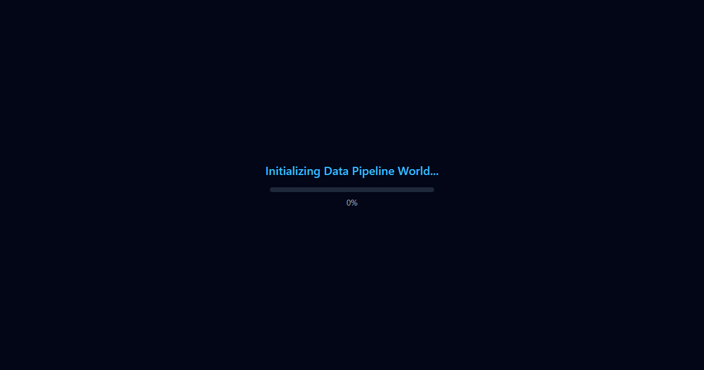

# 🚀 Interactive 3D Data Engineer Portfolio

> **Live Deployment:** [https://meetbhavsar2701.github.io/de-portfolio/](https://meetbhavsar2701.github.io/de-portfolio/)  
> **Accessible 2D Resume:** [https://meetbhavsar2701.github.io/de-portfolio/resume/](https://meetbhavsar2701.github.io/de-portfolio/resume/)  
> **Download Resume PDF:** [https://meetbhavsar2701.github.io/de-portfolio/resume.pdf](https://meetbhavsar2701.github.io/de-portfolio/resume.pdf)

A free-hosted, interactive 3D portfolio and resume experience built for a Data Engineer intern. Drive a small rover ("data packet carrier") through a pipeline-shaped world where each node highlights a section of my profile, skills, distributed transformation projects, and lakehouse experience.



---

## 🌟 Highlights & Features

- **Procedural 3D World**: Zero external 3D models or copyrighted assets. Built entirely with procedural geometries, shaders, instanced particle streams, and glowing dual pipeline rails.
- **Physics-driven Vehicle**: Responsive arcade rover powered by `@react-three/rapier` with torque steering, impulse acceleration, auto-righting rollover prevention, and respawn boundaries.
- **Pipeline Stations**:
  1. **Source**: Relational database cylinders & API gateways (About & Education).
  2. **Ingest**: Conveyor belt with rotating rollers and Kafka-style skill message crates you can bump.
  3. **Transform**: Industrial furnace forge with glowing Spark/dbt gears and project cards.
  4. **Warehouse**: 3-tiered Medallion Lakehouse tower (Bronze, Silver, Gold layers).
  5. **Dashboard**: Wall of telemetry screens with animated bar charts, donut SLA gauges, and achievements.
  6. **Output**: API gateway archway with LinkedIn/GitHub links and a Download Resume (PDF) button.
- **Embedded SQL Console**: Press `` ` `` (backtick) or tap the HUD button to execute live SQL queries (`SHOW TABLES`, `SELECT * FROM skills`, `SELECT * FROM experience WHERE ...`, etc.).
- **Synthesized Web Audio**: Procedural sound generation (ambient hum, velocity-tracked engine pitch, station chimes, impact thuds) using the Web Audio API with a persistent mute toggle.
- **Accessible 2D Resume Fallback**: Full standalone WCAG 2.1 AA accessible resume at `/resume/` with automatic redirection when WebGL or GPU acceleration is unavailable.
- **Automated Resume PDF**: Freshly compiled A4 print-ready PDF generated directly at build-time.

---

## 🎮 Controls

| Action | Desktop Controls | Mobile / Touch Controls |
|---|---|---|
| **Drive & Steer** | `W`, `A`, `S`, `D` or `Arrow Keys` | Left Virtual Joystick |
| **Brake** | `Spacebar` | Right Red `BRAKE` Button |
| **Reset Vehicle** | `R` Key | Right `RESET` Button |
| **SQL Console** | `` ` `` (Backtick) or HUD Button | HUD Button |
| **Station Info** | `E` to view / `Esc` to close | Tap on modal or card |
| **Audio Mute** | HUD Button | HUD Button |
| **Teleport** | Top Right Station Selector | Top Right Station Selector |

---

## 🛠 Tech Stack

- **Framework**: [React 18](https://react.dev/), [TypeScript](https://www.typescriptlang.org/), [Vite](https://vitejs.dev/)
- **3D & Physics**: [Three.js](https://threejs.org/), [@react-three/fiber](https://docs.pmnd.rs/react-three-fiber), [@react-three/drei](https://github.com/pmndrs/drei), [@react-three/rapier](https://github.com/pmndrs/react-three-rapier)
- **State Management**: [Zustand](https://github.com/pmndrs/zustand)
- **Testing & Verification**: [Vitest](https://vitest.dev/), [@testing-library/react](https://testing-library.com/), [Playwright](https://playwright.dev/), [@axe-core/playwright](https://github.com/dequelabs/axe-core-npm)
- **Styling & Assets**: Pure procedural CSS, KaTeX-free responsive overlays, and SVG favicons.

---

## 📂 Customizing Profile Content

All personal info, resume details, experience bullets, and skills are maintained in a single typed file:
`src/content/profile.ts`

To personalize your portfolio, simply edit the exported `PROFILE` object in that file. All 3D stations, HUD overlays, the SQL console database, and the `/resume/` page update automatically.

---

## 🚀 Running Locally

```bash
# 1. Clone repository
git clone https://github.com/MeetBhavsar2701/de-portfolio.git
cd de-portfolio

# 2. Install dependencies
npm install

# 3. Start local development server
npm run dev

# 4. Run automated test suite
npm run test       # Unit tests
npm run e2e        # Playwright E2E & Visual tests
npm run verify     # Full pipeline verification
```

---

## 📜 Credits & Attribution

See [CREDITS.md](./CREDITS.md) for full licensing details and third-party acknowledgments.

